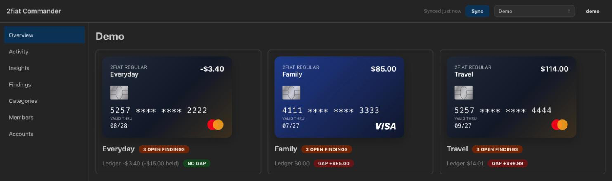
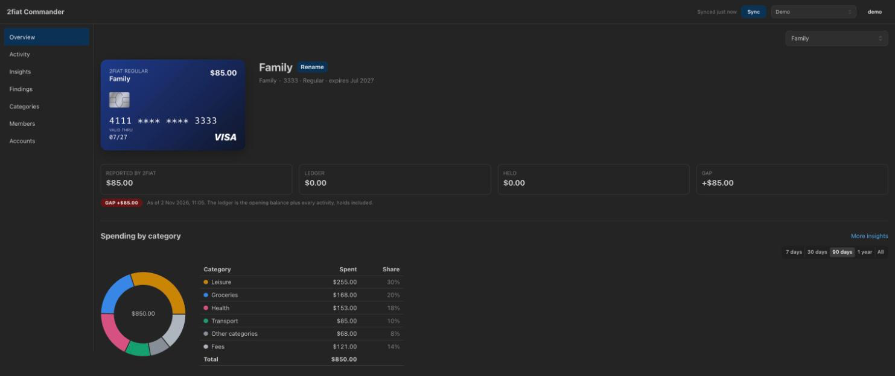

# 2fiat Commander

A self-hosted dashboard for your [2fiat](https://2fiat.com) virtual card accounts. 2fiat is a crypto-funded prepaid card
provider. Commander pulls your cards, transactions and top-ups into a local database, so you can see all your spending in one
place and find where 2fiat's reported balances and what its records explain don't agree.

- **Reconciliation**: compares each card's reported balance with a ledger built from its rows, and raises findings for
  balance gaps, short-credited top-ups, stale holds and fees above the advertised rate.
- **One ledger**: 2fiat's authorisation, posting and fee rows become one clear list of activity, and a card and its
  replacement become one card with one history.
- **Spending**: categories, notes and category rules, with charts for spending, cash flow, balance and fees, in your choice
  of display currency.
- **Several users**: invite others to an account, or to just one of its cards.

Commander is read-only towards 2fiat: it never tops up or moves money. It isn't affiliated with 2fiat, and it reads the
backend 2fiat's own website uses, which has no formal API, so a change on their side can break it.

_These screenshots use synthetic demo data._

### Overview



### Card page



## Install on a Mac

You need [proto](https://moonrepo.dev/proto), which installs the Node and pnpm versions pinned in `.prototools`. Install from
its own clone, separate from any checkout you develop in, because the clone it runs from becomes the installed app.

```sh
git clone git@github.com:nzjess/twofiat-commander.git ~/Applications/"2fiat Commander"
cd ~/Applications/"2fiat Commander"
proto use
pnpm install
pnpm app install
pnpm app user:add <username>
pnpm app open
```

The app runs as a launchd agent on `http://localhost:4310`, and starts when you log in. Log in with the user you made, then add
an account using the token from your 2fiat login link. Its secret key is kept in your login Keychain, and your data is in
`~/Library/Application Support/2fiat Commander/`, with a backup taken daily.

To update:

```sh
git pull && pnpm app update
```

`pnpm app` also has `status`, `logs`, `restart`, `backup`, `user:passwd <username>` and `uninstall`. Uninstalling keeps your data
and the Keychain secret.

## Install on StartOS

The StartOS package is in its own repo:
[nzjess/twofiat-commander-startos](https://github.com/nzjess/twofiat-commander-startos).

## Licence

[MIT](LICENSE)
